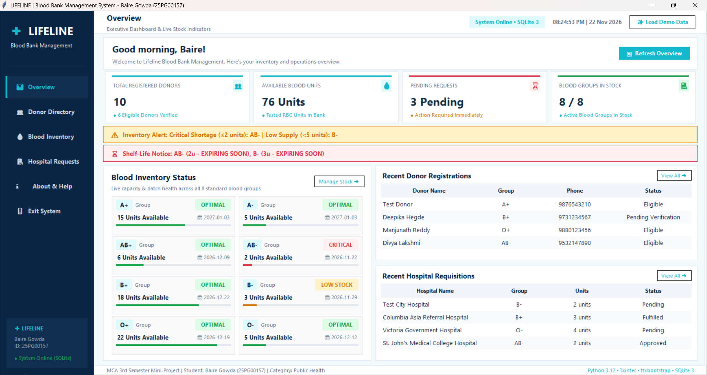
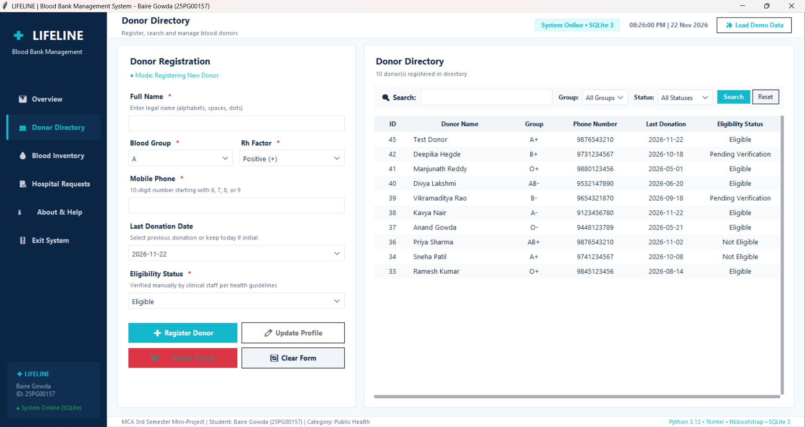
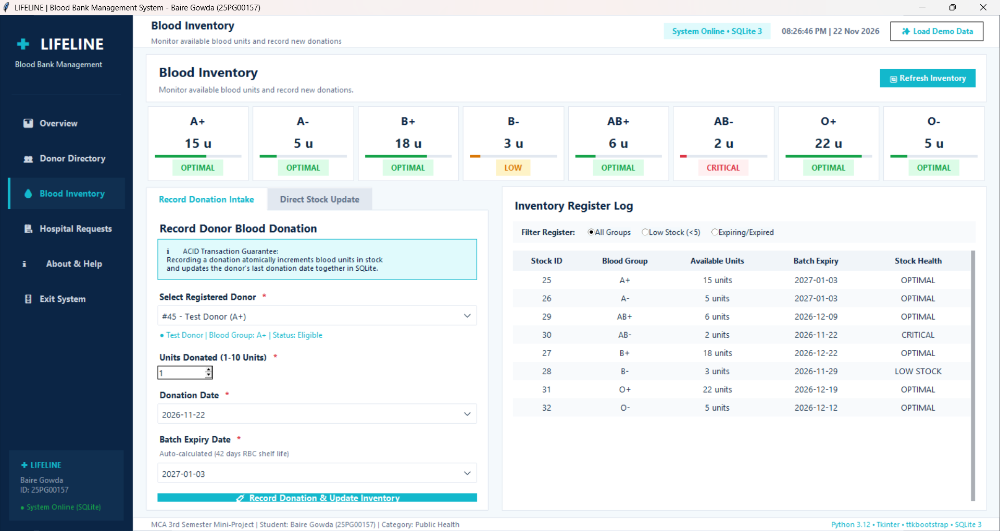
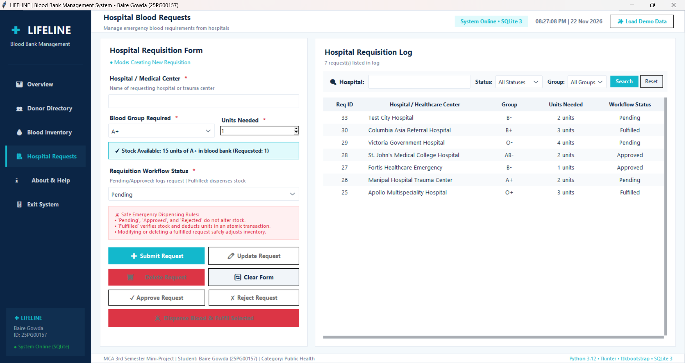
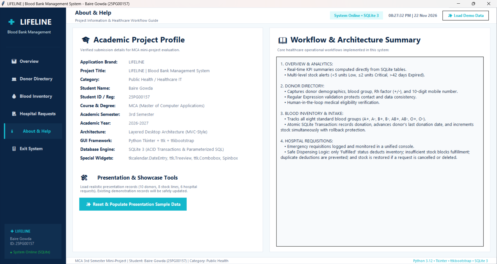

# LIFELINE — Blood Bank Donor Directory & Stock Tracker

A standalone desktop application for maintaining blood donor records, monitoring blood stock, and managing hospital blood requests. Developed as an MCA third-semester academic mini-project using **Python, Tkinter, and SQLite**.

<p align="center">
  
</p>

<p align="center">
  
  
  
  
  
</p>

---

## 1. Project Overview

Blood banks need to maintain donor information, available blood stock, and hospital requests. Managing these records manually can make it difficult to find donor details, check stock availability, and keep request information up to date.

**LIFELINE** brings these activities together in one desktop application. It allows users to manage donor records, monitor the eight standard blood groups, record donations, and process hospital requests. Application data is stored locally in an SQLite database.

The project was developed to practise Python GUI development, database connectivity, CRUD operations, input validation, exception handling, and database transaction management.

## 2. Project Details

| Item | Details |
|---|---|
| Project title | LIFELINE – Blood Bank Donor Directory & Stock Tracker |
| Project category | Public Health / Healthcare IT |
| Programme | Master of Computer Applications (MCA) |
| Semester | 3rd Semester |
| Developer | Baire Gowda |
| Application type | Standalone desktop application |
| Main technologies | Python, Tkinter, SQLite |

## 3. Main Features

### Dashboard
- Displays an overview of donor records, available blood units, pending requests, and stock information.
- Shows the eight standard blood groups: A+, A-, B+, B-, AB+, AB-, O+, and O-.
- Highlights low-stock and expiry-related information.
- Provides navigation to the main application modules.

### Donor Directory
- Register, view, search, update, and delete donor records.
- Store donor name, blood group (including its Rh designation), phone number, last donation date, and eligibility status.
- Validate required fields and phone number format.
- Search and filter donor records.

### Blood Inventory
- Monitor available units for all eight standard blood groups.
- Record donations and update the donor's last donation date and related stock.
- Make stock adjustments.
- View stock and expiry information in the inventory register.

### Hospital Requests
- Record hospital name, required blood group, and number of units needed.
- Manage request statuses: Pending, Approved, Rejected, and Fulfilled.
- Check stock availability before fulfilling a request.
- Deduct stock when a request is fulfilled, not merely when it is submitted or approved.
- Prevent duplicate stock deductions and restore stock when a fulfilled request is reverted or deleted.

### About & Help
- Displays project information, technology details, and a summary of the application workflow.

## 4. Application Screenshots

The following screenshots show the main application screens.

| Screen | Screenshot |
|---|---|
| Dashboard |  |
| Donor Directory |  |
| Blood Inventory |  |
| Hospital Requests |  |
| About & Help |  |

## 5. Technology Stack

| Technology | Purpose |
|---|---|
| Python 3.12 | Application programming language |
| Tkinter and `ttk` | Desktop graphical user interface |
| `ttkbootstrap` | Themed interface components |
| SQLite 3 | Local relational database |
| Python `sqlite3` | Database connectivity and SQL operations |
| `tkcalendar` | Date selection |
| `Pillow` | Image handling |
| `re` | Regular-expression based input validation |

The interface uses Tkinter layout managers such as `pack()` and `grid()`, with widgets including labels, entry fields, buttons, comboboxes, spinboxes, date pickers, message boxes, and `ttk.Treeview`.

## 6. Application Architecture

The project is organised into three main layers:

1. **Presentation layer** — Tkinter screens and reusable interface components.
2. **Application logic and validation layer** — application workflows and input checks.
3. **Database layer** — SQLite connections, SQL operations, and transaction handling.

```text
                 User
                  |
                  v
         Tkinter Desktop Interface
                  |
                  v
        Application Logic & Validation
                  |
                  v
           Database Access Layer
                  |
                  v
               SQLite 3
             /    |     \
         DONORS  BLOOD_STOCK  REQUESTS
```

## 7. Database Design

The application uses three main tables:

| Table | Purpose | Main fields |
|---|---|---|
| `DONORS` | Stores donor information | `donor_id`, `name`, `blood_group`, `phone`, `last_donation_date`, `eligibility` |
| `BLOOD_STOCK` | Stores available blood stock | `stock_id`, `blood_group`, `units_available`, `expiry_date` |
| `REQUESTS` | Stores hospital requests | `req_id`, `hospital_name`, `blood_group`, `units_needed`, `req_status` |

The database file is located at `database/blood_bank.db`. The application creates or initialises the database when required.

**About `sqlite_sequence`:** SQLite automatically maintains an internal table named `sqlite_sequence` for tables that use `AUTOINCREMENT`. DB Browser for SQLite may therefore display this internal table alongside the three application tables. The three main application tables are `DONORS`, `BLOOD_STOCK`, and `REQUESTS`.

### Data Handling
- Parameterized SQL statements are used to pass values to database queries.
- Input validation is performed before relevant records are saved.
- Transactions are used for related updates, such as recording a donation and updating stock.
- Stock availability is checked before a hospital request is fulfilled.

## 8. Project Structure

```text
Blood Bank Donor Directory & Stock Tracker/
│
├── main.py                  # Application entry point and navigation
├── config.py                # Application settings and theme constants
├── ui_components.py         # Reusable interface components
├── database.py              # SQLite database operations
├── validators.py            # Input validation functions
├── dashboard.py             # Dashboard module
├── donor.py                 # Donor directory module
├── blood_stock.py           # Blood inventory and donation intake
├── requests.py              # Hospital request management
├── requirements.txt         # Python package dependencies
├── capture_screenshots.py   # Screenshot capture utility
├── README.md                # Project documentation
│
├── database/
│   └── blood_bank.db        # Local SQLite database
│
├── tests/
│   ├── test_app.py          # Database and business-logic tests
│   └── test_gui.py          # GUI integration tests
│
├── assets/                  # Application assets
├── screenshots/             # Application screenshots
│   ├── 01_dashboard.png
│   ├── 02_donor_directory.png
│   ├── 03_blood_inventory.png
│   ├── 04_hospital_requests.png
│   └── 05_about_help.png
│
└── documentation/
    ├── Project_Report.md
    ├── Database_Design.md
    ├── User_Guide.md
    ├── Viva_Questions.md
    └── Screenshot_Checklist.md
```

## 9. Installation and Setup

### Requirements
- Windows 10 or Windows 11
- Python 3.12 recommended
- `pip` available from the command line

### Step 1 — Open the project folder

Open PowerShell or Command Prompt in the project directory:

```powershell
cd "Blood Bank Donor Directory & Stock Tracker"
```

### Step 2 — Install dependencies

```powershell
python -m pip install -r requirements.txt
```

### Step 3 — Run the application

```powershell
python main.py
```

The LIFELINE desktop application should open in a separate window.

### Database File

The application stores its data locally in:

```text
database/blood_bank.db
```

Keep this file inside the project's `database` folder when running the application. It contains the donor, blood stock, and hospital request records.

## 10. Running the Tests

Run the automated test suite from the project directory:

```powershell
python -m unittest discover -s tests -v
```

The tests are intended to check database setup, validation, donor operations, donation intake, request fulfilment, and GUI workflows.

### Latest Reported Test Results

The latest test run reported by the development environment showed:

| Result | Count |
|---|---:|
| Total tests | 18 |
| Passed | 18 |
| Failed | 0 |
| Errors | 0 |

These figures are based on the latest reported run. Run the command above in your local environment to verify the results on your computer.

## 11. Input Validation and Data Safety

The application checks required values, donor details, phone number format, dates, and numeric unit quantities. It uses message boxes to provide feedback to the user.

For hospital requests, stock is checked before fulfilment. The application is designed to prevent stock from becoming negative and to avoid deducting stock more than once for the same fulfilled request.

Parameterized SQL queries are used to pass user-provided values to database operations.

## 12. Scope and Limitations

- The application is a local desktop project using an SQLite database.
- It is designed for academic demonstration and learning, not as a certified clinical blood bank system.
- Donor eligibility is recorded by the user and must be verified by authorised medical staff.
- Online access, multi-branch synchronisation, and external hospital integration are not included.
- SMS and email notifications are possible future additions.

## 13. Possible Future Improvements

- Add user login and role-based access.
- Generate printable or downloadable stock and request reports.
- Add SMS or email alerts for urgent blood requirements.
- Introduce barcode or QR-code support for blood bag identification.
- Support a central database if the application is extended to multiple locations.
- Maintain a detailed audit history of stock changes.

## 14. Learning Outcomes

While developing this project, I practised:

- Building a standalone GUI application using Python Tkinter.
- Connecting a Python application with an SQLite database.
- Performing CRUD operations using SQL.
- Validating user input and handling errors.
- Using database transactions for related updates.
- Organising a Python project into separate modules.
- Testing application workflows and documenting the results.

## 15. References

- [Python Documentation](https://docs.python.org/3/)
- [Tkinter Documentation](https://docs.python.org/3/library/tkinter.html)
- [Python `sqlite3` Documentation](https://docs.python.org/3/library/sqlite3.html)
- [SQLite Documentation](https://www.sqlite.org/docs.html)
- [tkcalendar Documentation](https://tkcalendar.readthedocs.io/)

---

**LIFELINE — Blood Bank Donor Directory & Stock Tracker**

*MCA 3rd Semester Academic Mini-Project*
