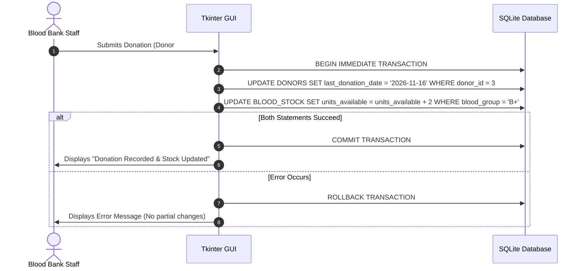

# DATABASE DESIGN & TECHNICAL SPECIFICATION

**Project:** Blood Bank Donor Directory & Stock Tracker  
**Student:** Baire Gowda (25PG00157)  
**Course:** MCA 3rd Semester  
**Database Engine:** SQLite 3 (`blood_bank.db`)  

---

## 1. DATABASE PHILOSOPHY & OBJECTIVES

The database layer serves as the single source of truth for all healthcare assets within the application. In compliance with the non-negotiable requirements of the professor:
1. Exactly **three primary tables** are created: `DONORS`, `BLOOD_STOCK`, and `REQUESTS`.
2. All SQL commands utilize **parameterized queries (`?`)** to prevent SQL injection.
3. Multi-table modifications are wrapped in **explicit ACID transactions** with `commit()` and `rollback()` handling.
4. Appropriate database indices are created on frequently queried columns (`blood_group`, `phone`, `req_status`) to guarantee $O(\log n)$ search performance.

---

## 2. RELATIONAL SCHEMA SPECIFICATION

```
+------------------------------------------------------------------------+
|                                 DONORS                                 |
+------------------------------------------------------------------------+
| * donor_id            : INTEGER PRIMARY KEY AUTOINCREMENT              |
|   name                : TEXT NOT NULL                                  |
|   blood_group         : TEXT NOT NULL                                  |
|   phone               : TEXT NOT NULL                                  |
|   last_donation_date  : TEXT                                           |
|   eligibility         : TEXT NOT NULL                                  |
+------------------------------------------------------------------------+

+------------------------------------------------------------------------+
|                              BLOOD_STOCK                               |
+------------------------------------------------------------------------+
| * stock_id            : INTEGER PRIMARY KEY AUTOINCREMENT              |
|   blood_group         : TEXT NOT NULL                                  |
|   units_available     : INTEGER NOT NULL DEFAULT 0                     |
|   expiry_date         : TEXT                                           |
+------------------------------------------------------------------------+

+------------------------------------------------------------------------+
|                                REQUESTS                                |
+------------------------------------------------------------------------+
| * req_id              : INTEGER PRIMARY KEY AUTOINCREMENT              |
|   hospital_name       : TEXT NOT NULL                                  |
|   blood_group         : TEXT NOT NULL                                  |
|   units_needed        : INTEGER NOT NULL                               |
|   req_status          : TEXT NOT NULL                                  |
+------------------------------------------------------------------------+
```

---

## 3. TABLE DICTIONARIES

### Table 1: `DONORS`
Stores personal identification, contact details, blood group, and medical eligibility for volunteer blood donors.

| Column Name | Data Type | Constraints | Description |
| :--- | :--- | :--- | :--- |
| `donor_id` | `INTEGER` | `PRIMARY KEY AUTOINCREMENT` | Unique identifier for each donor. |
| `name` | `TEXT` | `NOT NULL` | Donor's full name (2–70 chars). |
| `blood_group` | `TEXT` | `NOT NULL` | Combined blood type & Rh factor (`A+`, `O-`, etc.). |
| `phone` | `TEXT` | `NOT NULL` | 10-digit mobile phone number. |
| `last_donation_date`| `TEXT` | `NULLABLE` | Date of last donation in `YYYY-MM-DD` format. |
| `eligibility` | `TEXT` | `NOT NULL` | Medical status (`Eligible`, `Not Eligible`, `Pending Verification`). |

### Table 2: `BLOOD_STOCK`
Maintains current inventory balances and shelf-life expiry dates for all 8 standard blood groups.

| Column Name | Data Type | Constraints | Description |
| :--- | :--- | :--- | :--- |
| `stock_id` | `INTEGER` | `PRIMARY KEY AUTOINCREMENT` | Unique identifier for each inventory line. |
| `blood_group` | `TEXT` | `NOT NULL` | One of `A+`, `A-`, `B+`, `B-`, `AB+`, `AB-`, `O+`, `O-`. |
| `units_available` | `INTEGER` | `NOT NULL DEFAULT 0` | Available usable units in the blood bank ($\ge 0$). |
| `expiry_date` | `TEXT` | `NULLABLE` | Current batch expiry date (`YYYY-MM-DD`). |

> **Academic Note on Single Expiry Date:**  
> In an enterprise industrial ERP, every donated blood pouch carries a unique RFID barcode and individual expiration date. In this academic project model, a single expiration date represents the earliest expiration batch for that blood group.

### Table 3: `REQUESTS`
Maintains emergency blood requisition requests submitted by affiliated hospitals and healthcare centers.

| Column Name | Data Type | Constraints | Description |
| :--- | :--- | :--- | :--- |
| `req_id` | `INTEGER` | `PRIMARY KEY AUTOINCREMENT` | Unique identifier for the hospital request. |
| `hospital_name` | `TEXT` | `NOT NULL` | Name of the requesting hospital / trauma center. |
| `blood_group` | `TEXT` | `NOT NULL` | Required blood group. |
| `units_needed` | `INTEGER` | `NOT NULL` | Units requested ($> 0$). |
| `req_status` | `TEXT` | `NOT NULL` | Status: `Pending`, `Approved`, `Rejected`, or `Fulfilled`. |

---

## 4. PERFORMANCE INDEXES

To optimize query latency across growing directories:
```sql
CREATE INDEX IF NOT EXISTS idx_donors_bg ON DONORS(blood_group);
CREATE INDEX IF NOT EXISTS idx_donors_phone ON DONORS(phone);
CREATE INDEX IF NOT EXISTS idx_stock_bg ON BLOOD_STOCK(blood_group);
CREATE INDEX IF NOT EXISTS idx_req_status ON REQUESTS(req_status);
CREATE INDEX IF NOT EXISTS idx_req_bg ON REQUESTS(blood_group);
```

---

## 5. TRANSACTIONAL WORKFLOWS & SAFE INVENTORY LOGIC

### Workflow A: Atomic Donation Intake


### Workflow B: Safe Request Dispensing (Fulfillment)
When hospital request #10 requests 3 units of `O+` and is marked `Fulfilled`:
1. Check current units:
   $$\text{SELECT units\_available FROM BLOOD\_STOCK WHERE blood\_group = 'O+'}$$
2. If `units_available < 3`:
   - Raise `Insufficient Stock` error.
   - Roll back transaction.
   - Do **not** deduct stock.
   - Do **not** set status to `Fulfilled`.
3. If `units_available >= 3`:
   - Deduct:
     $$\text{UPDATE BLOOD\_STOCK SET units\_available = units\_available - 3 WHERE blood\_group = 'O+'}$$
   - Update request status:
     $$\text{UPDATE REQUESTS SET req\_status = 'Fulfilled' WHERE req\_id = 10}$$
   - Commit transaction.

### Workflow C: Prevention of Duplicate Stock Deductions
When a user updates an existing request:
- **Case 1 (Was Pending $\to$ Now Fulfilled):** Deduct requested units.
- **Case 2 (Was Fulfilled $\to$ Remains Fulfilled):** If quantity is unchanged, **0** stock change occurs. If quantity changes from $q_1$ to $q_2$, net change is $\Delta = q_2 - q_1$.
- **Case 3 (Was Fulfilled $\to$ Now Rejected/Pending):** Returned units are restored to `BLOOD_STOCK`.
- **Case 4 (Was Pending $\to$ Now Approved/Rejected):** 0 stock change.
