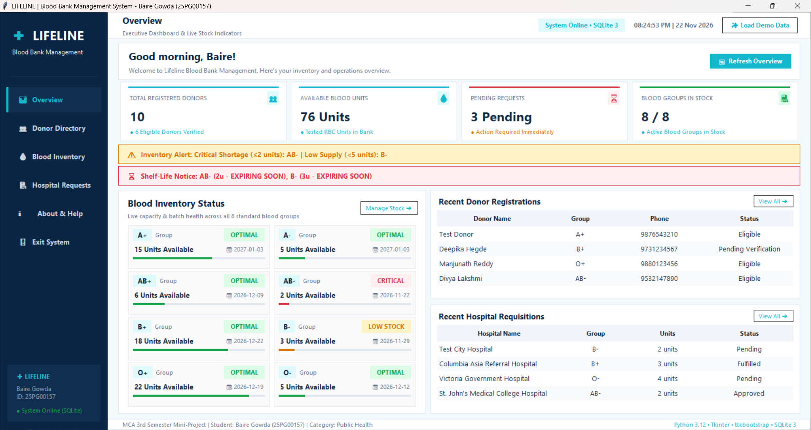
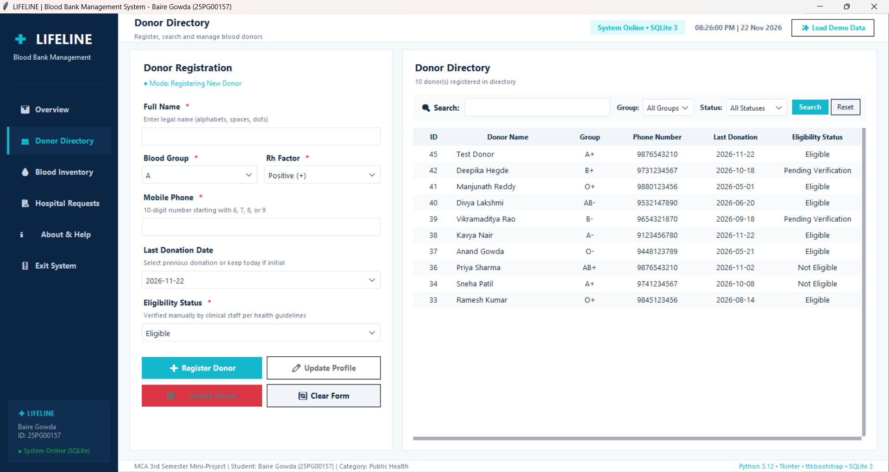
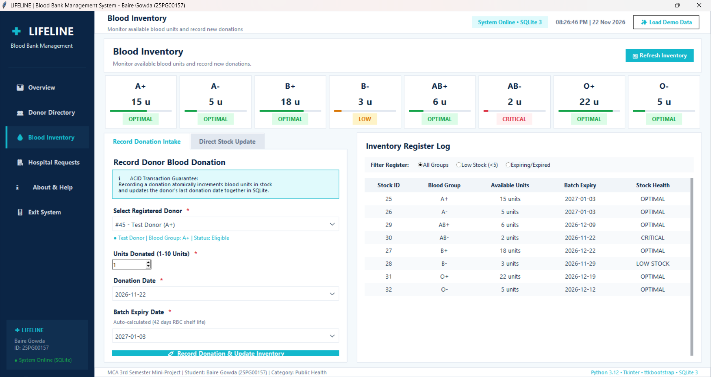
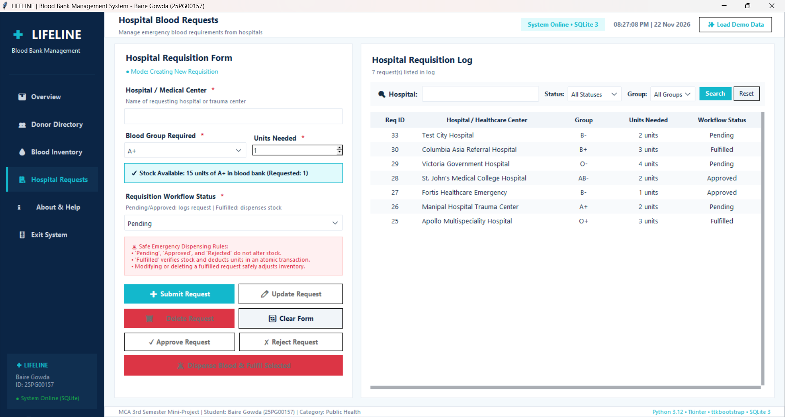
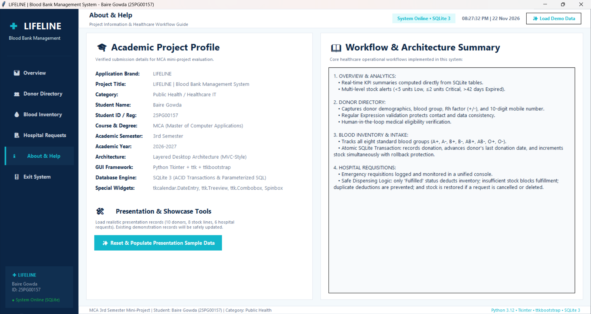

# ACADEMIC PROJECT REPORT

## LIFELINE – BLOOD BANK DONOR DIRECTORY & STOCK TRACKER

**Project Category:** Public Health / Healthcare IT  
**Student Name:** Baire Gowda  
**Register Number:** 25PG00157  
**Programme:** Master of Computer Applications (MCA)  
**Semester:** 3rd Semester  
**Academic Year:** 2026–2027  
**Presentation Date:** 25 November 2026  

---

## Abstract

LIFELINE – Blood Bank Donor Directory & Stock Tracker is a standalone desktop application developed to help a blood bank maintain donor details, monitor available blood units and manage blood requests from hospitals. Maintaining these records manually can take time and may lead to mistakes, such as incorrect donor details, outdated stock information or delays when checking whether a requested blood group is available.

The application is developed using Python and Tkinter for the graphical user interface. SQLite is used to store the information in a local database. The system has five main screens: Overview Dashboard, Donor Directory, Blood Inventory, Hospital Requests, and About & Help.

The Donor Directory allows the user to add, view, search, update and delete donor records. The Blood Inventory screen displays the eight standard blood groups and their available units. It also provides a donation intake feature to increase stock when a donation is recorded. The Hospital Requests screen allows the user to create and manage hospital requests. Stock is deducted when a request is fulfilled, subject to availability checks.

This project helped me understand how to develop a desktop application, connect Python with an SQLite database, create forms and tables using Tkinter widgets, validate user input and manage database operations.

## 1. Introduction

Blood is required for many medical situations, including accidents, surgeries and other emergencies. A blood bank needs to maintain correct information about donors and the quantity of blood available for each blood group. It also needs to keep track of requests received from hospitals.

When these activities are handled using paper records or separate spreadsheets, it can become difficult to find information quickly and keep records updated. The LIFELINE project was developed as a small desktop-based system to bring these activities together in one application.

The application runs on a computer and does not require a web browser. Its records are stored locally in an SQLite database.

## 2. Problem Statement

Maintaining donor details, blood stock and hospital requests manually can create difficulties. Searching for a donor may take time, stock quantities may not be updated immediately after a donation or issue, and staff may find it difficult to identify low-stock or expired batches.

The project aims to provide a simple desktop application where donor records, blood inventory and hospital requests can be managed from a single system.

## 3. Objectives

The main objectives of this project are:

1. To develop a standalone desktop application using Python Tkinter.
2. To store donor, stock and hospital request details in an SQLite database.
3. To provide operations to add, view, search, update and delete donor records.
4. To display stock details for all eight standard blood groups.
5. To record blood donations and update the related stock information.
6. To manage hospital requests and update their status.
7. To check stock availability before fulfilling a request.
8. To validate user input and display suitable messages when information is incorrect.

## 4. Scope of the Project

The application is intended as an academic mini-project demonstrating basic blood bank record and stock management. It includes donor record management, stock monitoring, donation intake and hospital request management.

The application is a local desktop system. It does not currently connect to hospital networks, blood bank services, SMS gateways or online donor databases. Donor eligibility is entered and maintained by the user; the application does not perform medical screening.

## 5. Software and Hardware Requirements

### 5.1 Software Requirements

| Component | Technology |
|---|---|
| Programming language | Python 3 |
| Desktop GUI | Tkinter and ttk widgets |
| UI theme | ttkbootstrap |
| Database | SQLite 3 |
| Database interface | Python `sqlite3` module |
| Date selection | `tkcalendar.DateEntry` |
| Image support | Pillow (where used) |
| Code editor | Antigravity IDE / Visual Studio Code |
| Operating system | Windows 10 / Windows 11 |

### 5.2 Hardware Requirements

The application can run on a standard Windows computer with Python installed. A keyboard, mouse and display are required. Actual memory and storage requirements depend on the computer and installed Python packages.

## 6. Technologies Used

- **Python:** Used to write the application logic.
- **Tkinter:** Used to create the desktop windows, forms, labels and buttons.
- **ttk / ttkbootstrap:** Used for themed widgets and the application appearance.
- **SQLite:** Used to store records in a local database file.
- **sqlite3:** Used by Python to execute SQL statements and communicate with SQLite.
- **tkcalendar:** Used to select dates through a calendar widget.
- **Regular expressions (`re`):** Used for input checks such as mobile number validation.

## 7. System Architecture

The application follows a simple layered desktop architecture.

### 7.1 Presentation Layer

This layer contains the screens and widgets displayed to the user. The main application window and views are implemented using files such as `main.py`, `dashboard.py`, `donor.py`, `blood_stock.py` and `requests.py`.

### 7.2 Business Logic and Validation Layer

This layer contains the rules used by the application. It checks user input, validates values and controls operations such as donor registration, donation intake and request fulfilment. The `validators.py` module contains validation functions.

### 7.3 Database Layer

The `database.py` module manages SQLite database connections and SQL operations. Parameterized SQL statements are used when values are supplied by the user. Database transactions are used for operations that involve more than one related update.

### 7.4 Architecture Flow

```text
User
  |
  v
Tkinter Desktop Interface
  |
  v
Application Logic and Input Validation
  |
  v
Database Access Module
  |
  v
SQLite Database
  |
  +-- DONORS
  +-- BLOOD_STOCK
  +-- REQUESTS
```

## 8. Main Modules of the Application

### 8.1 Overview Dashboard

The dashboard provides a summary of the current records. It displays the total number of registered donors, available blood units, pending requests and the number of blood groups with stock. It also shows stock information for the eight blood groups and highlights low-stock or expiry-related information based on the stored data.

**Screenshot 1 – Overview Dashboard**



### 8.2 Donor Directory

The Donor Directory is used to manage donor information. The form includes the donor's name, blood group, Rh factor, mobile number, last donation date and eligibility status.

The user can register a new donor, select an existing record, update details, delete a record and search the donor list. Input validation is used to check required fields and mobile number format.

**Screenshot 2 – Donor Directory**



### 8.3 Blood Inventory

The Blood Inventory screen displays the available units for A+, A-, B+, B-, AB+, AB-, O+ and O-. It provides a donation intake operation and a direct stock update option.

When a donation is recorded, the application updates the donor's last donation date and increases the related blood stock within a database transaction. The screen also displays batch expiry information where available.

**Screenshot 3 – Blood Inventory**



### 8.4 Hospital Requests

The Hospital Requests screen is used to record blood requirements received from hospitals. A request contains the hospital name, required blood group, number of units and request status.

Requests can be submitted, updated, approved, rejected and fulfilled. Stock is not deducted merely because a request is submitted or approved. When the user fulfils a request, the application checks whether sufficient stock is available before deducting the requested units. The application also includes logic to avoid repeated deductions and to restore stock when a fulfilled request is reverted or deleted.

**Screenshot 4 – Hospital Requests**



### 8.5 About & Help

The About & Help screen displays the project information, student and course details, technologies used and a short explanation of the application workflow.

**Screenshot 5 – About & Help**



## 9. Database Design

The project uses SQLite. The database file is stored locally in the project's `database` folder. The application is designed around the three primary tables specified for the project.

### 9.1 DONORS Table

| Field | Description |
|---|---|
| donor_id | Unique donor ID and primary key |
| name | Donor name |
| blood_group | Donor blood group |
| phone | Donor mobile number |
| last_donation_date | Date of the donor's last donation |
| eligibility | Donor eligibility status |

### 9.2 BLOOD_STOCK Table

| Field | Description |
|---|---|
| stock_id | Unique stock record ID and primary key |
| blood_group | Blood group for the stock record |
| units_available | Number of available units |
| expiry_date | Expiry date recorded for the stock |

### 9.3 REQUESTS Table

| Field | Description |
|---|---|
| req_id | Unique request ID and primary key |
| hospital_name | Name of the requesting hospital |
| blood_group | Required blood group |
| units_needed | Number of units requested |
| req_status | Current request status |

### 9.4 Database Operations

The application performs create, read, update and delete operations where required. Parameterized SQL queries are used to pass values to SQL statements. For multi-step operations such as donation intake and stock fulfilment, transactions help ensure that related database changes are committed together or rolled back if an error occurs.

## 10. Input Validation and Error Handling

Input validation helps prevent incorrect information from being stored. The application checks required fields, donor name, mobile number, dates and numeric unit values.

Examples include:

- Required fields should not be left empty.
- A mobile number should follow the expected 10-digit format.
- Unit values should be valid positive numbers within the limits set by the form.
- A future date should not be accepted as a previous donation date.
- A request should not be fulfilled if sufficient stock is not available.

Message boxes are used to show success, warning and error messages. Exception handling is used around database and application operations to handle unexpected errors.

## 11. Testing and Results

The application was manually tested using the main screens and common workflows.

| Test | What was checked | Result |
|---|---|---|
| Dashboard | Dashboard opens and displays summary information | Passed during manual testing |
| Donor registration | Add a donor and view it in the directory | Passed during manual testing |
| Donor update and delete | Update and delete a test donor | Passed during manual testing |
| Donor validation | Check empty name and invalid mobile number | Passed during manual testing |
| Blood inventory | Display all eight blood groups and stock quantities | Passed during manual testing |
| Donation intake | Record a test donation and check stock update | Passed during manual testing |
| Hospital request submission | Create a test hospital request | Passed during manual testing |
| Request update and approval | Change request details and approve it | Passed during manual testing |
| Request fulfilment | Fulfil an approved request and check stock deduction | Passed during manual testing |
| Request rejection | Reject a test request and check that stock is unchanged | Passed during manual testing |

The database/business-logic unit tests were also run against the supplied project files: **11 unit tests passed**. The three GUI integration tests should be run on the target Windows computer before reporting a combined 14-test result.

## 12. Limitations

1. The application stores information in a local SQLite database on one computer.
2. It does not currently provide online access for multiple hospitals or branches.
3. It does not send SMS or email notifications to donors.
4. Medical eligibility is recorded by the user and must be verified by qualified staff.
5. The application is an academic project and should not be treated as a certified clinical blood bank system.

## 13. Future Enhancements

The project can be improved in the future by adding:

1. SMS or email alerts for urgent blood requirements.
2. Barcode or QR-code support for identifying blood bags.
3. PDF reports for stock, donors and hospital requests.
4. User login and role-based access for staff.
5. A centralised database for multiple branches, if required.
6. More detailed audit logs for stock changes.

## 14. Conclusion

LIFELINE – Blood Bank Donor Directory & Stock Tracker was developed as a Python-based desktop application using Tkinter and SQLite. It brings donor management, blood stock monitoring, donation intake and hospital request handling into one system.

Through this project, I gained practical experience in creating a desktop GUI, connecting Python with a database, using SQL queries, validating form inputs and handling database transactions. I also learned how to test the main workflows and present information through tables and dashboard summaries.

The project meets the main purpose of the academic mini-project by demonstrating how a simple desktop application can help organise basic blood bank records and stock information.

## 15. References

1. Python Software Foundation, *Python Documentation* – https://docs.python.org/3/
2. Python Software Foundation, *Tkinter – Python Interface to Tcl/Tk* – https://docs.python.org/3/library/tkinter.html
3. SQLite, *SQLite Documentation* – https://www.sqlite.org/docs.html
4. Python Software Foundation, *sqlite3 – DB-API 2.0 Interface for SQLite Databases* – https://docs.python.org/3/library/sqlite3.html
5. tkcalendar, *tkcalendar Documentation* – https://tkcalendar.readthedocs.io/

---

**End of Report**
